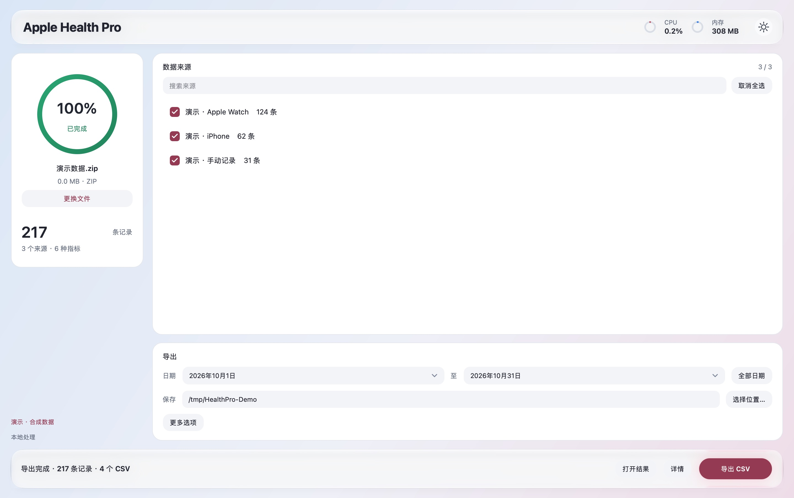
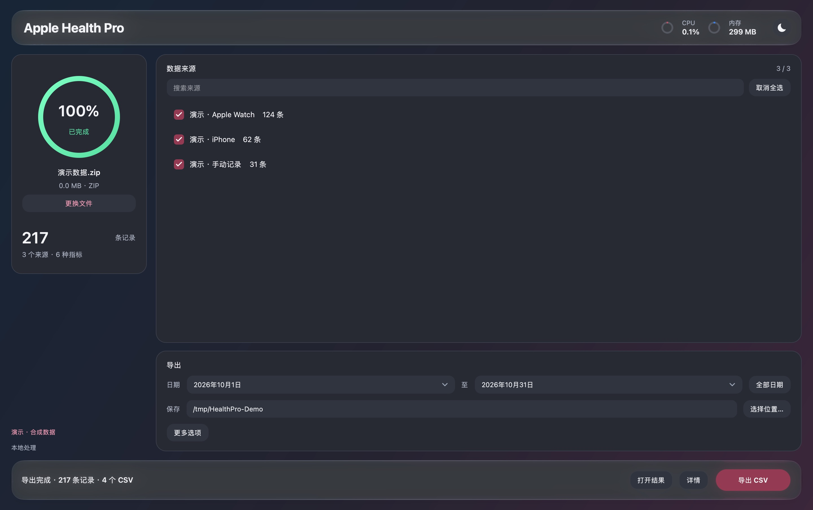
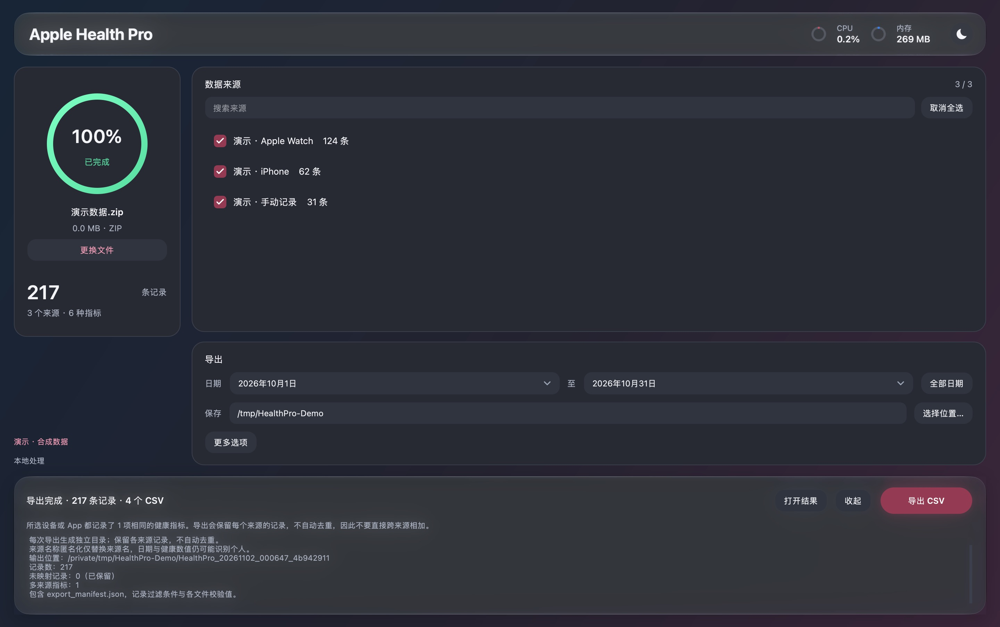

# Apple Health Pro

把 Apple 健康导出 ZIP 转成按来源、日期与指标分类的 CSV / JSONL。桌面操作或命令行自动化，全部在本机完成。

A local desktop app and CLI for converting Apple Health exports into categorized CSV and JSON Lines.

[下载 v8.9.1](https://github.com/leecdiang/Apple-Health-Pro/releases/tag/v8.9.1) · [CLI 文档](docs/cli.md) · [更新记录](CHANGELOG.md) · [问题反馈](https://github.com/leecdiang/Apple-Health-Pro/issues)

## 界面

macOS 实机截图，全部使用应用内置的 **217 条合成演示记录**。
启动时跟随系统外观；右上角小按钮可直接切换深浅色。

| 浅色 | 深色 |
| --- | --- |
|  |  |

<details>
<summary>查看导出完成与数据清单说明</summary>



</details>

macOS 26+ 使用原生 Liquid Glass，较早 macOS 使用系统模糊材质；Windows / Linux 使用实色界面。玻璃效果会随系统与辅助功能设置变化。

## 下载

桌面版适合交互式 CSV 导出；独立 CLI 支持 CSV / JSONL，无需安装 Python 或 Qt。下面的文件均位于 [v8.9.1 Release](https://github.com/leecdiang/Apple-Health-Pro/releases/tag/v8.9.1)，附 `SHA256SUMS.txt`。

| 平台 | 桌面版 | 独立 CLI |
| --- | --- | --- |
| macOS Apple Silicon | `HealthPro_v8.9.1_macOS_AppleSilicon.dmg` | `HealthProCLI_v8.9.1_macOS_AppleSilicon.tar.gz` |
| macOS Intel | `HealthPro_v8.9.1_macOS_Intel.dmg` | `HealthProCLI_v8.9.1_macOS_Intel.tar.gz` |
| Windows x64 | `HealthPro_Setup_v8.9.1.exe` | `HealthProCLI_v8.9.1_Windows.exe` |
| Linux x86_64 | `healthpro_8.9.1_amd64.deb` / `HealthPro-8.9.1-x86_64.AppImage` | `HealthProCLI_v8.9.1_Linux.tar.gz` |

macOS 包采用 ad-hoc 签名，尚未进行 Developer ID 公证。

## CLI 快速开始

### macOS / Linux：独立程序

解压对应平台的 CLI 压缩包，在终端进入解压目录：

```bash
./healthpro-cli --version
# 列出原始来源名称，供精确筛选使用
./healthpro-cli sources --input export.zip --quiet

# 输出目录需事先存在；每次导出创建新的结果子目录
mkdir -p output
./healthpro-cli export --input export.zip --output ./output --format jsonl

# 导出指定来源与日期；来源名称必须与 sources 的结果完全一致
./healthpro-cli export --input export.zip --output ./output --format csv \
  --source-filter "Apple Watch" \
  --start-date 2026-01-01 --end-date 2026-10-31
```

### Windows PowerShell

```powershell
New-Item -ItemType Directory -Force output | Out-Null
.\HealthProCLI_v8.9.1_Windows.exe sources --input .\export.zip --quiet
.\HealthProCLI_v8.9.1_Windows.exe export --input .\export.zip --output .\output --format jsonl
```

### 从源码运行

在仓库根目录运行，仅需 Python 3.9+ 标准库，**不需要安装 GUI 依赖**：

```bash
python -m healthpro sources --input export.zip --quiet
python -m healthpro export --input export.zip --output ./output --format jsonl
python -m healthpro export --help
```

`--source-filter` 可重复指定多个来源；省略时选择全部来源。默认匿名化来源名，CSV 同时启用 Excel 安全文本。
JSONL 每行一个对象，保留原始数值字符串，另提供数值辅助字段与嵌套运动统计。成功结果以单个 JSON 对象写入 stdout，进度和错误写入 stderr；使用 `--quiet` 隐藏进度，适合脚本重定向。

```bash
./healthpro-cli export --input export.zip --output ./output --format jsonl --quiet > result.json
```

完整参数、JSONL schema、精度说明和退出码见 [CLI 文档](docs/cli.md)。

## 功能

- 两遍流式解析，不保留全量 DataFrame；按来源、日期与唯一主分类导出，未知 Record 类型单独保留。
- 保留原始起止时间、时区、数值与单位，以及可用的运动统计。
- 独立结果目录、分片输出、失败或取消清理，以及包含行数与 SHA-256 的导出清单。
- CPU / 内存圆环、阶段配色进度、深浅色切换；macOS 原生 ZIP / 文件夹选择面板。
- 完全本地处理，默认匿名化来源名；保留多来源原始记录，不自动去重。

## 使用

1. 在 iPhone 健康 App 中选择头像 → 导出所有健康数据，获得 ZIP。
2. 打开应用，选择或拖入 ZIP。完整扫描后勾选要导出的来源。
3. 选择日期和输出文件夹。日期范围按记录 **startDate 的原时区自然日**，两端包含；不会把跨午夜记录拆成每天的片段。
4. 点击“导出 CSV”。完成后点击“打开结果文件夹”，查看 CSV 和 `export_manifest.json`。

默认启用“匿名化来源名称”及“Excel 安全文本”。无来源或日期倒置时不能导出；空筛选结果不创建成功目录。
可通过“文件 → 载入演示数据”体验流程，演示记录全部为合成数据。
云盘或受系统管理的文件夹可能有额外读取等待；大文件建议先下载到本机。取消会等待当前系统文件读写返回后清理。

### 多来源与隐私

输出是 **raw records union**，不复现 Health App 的来源优先级，也不自动去重。
多个来源对同一指标有记录时，可在“详情”查看重叠说明，清单列出相应指标。不能直接跨来源累加步数或距离。

匿名化仅把 `sourceName` 替换为任务内一致的 `Source_001` 等标签；不导出源名称映射、设备描述或自由文本元数据。日期与健康数值仍可识别个人，匿名化不是完全去标识化。

Excel 安全文本会为可能被表格软件识别为公式的文本加单引号前缀，合法数字（含负数）保持不变。
用于机器处理、需要精确原始文本时可关闭；不要把不可信 CSV 当作可信表格打开。

### 输出格式

CSV 使用 UTF-8 BOM，字段顺序为：

```
type,value,unit,startdate,sourcename,enddate,record_kind,duration,durationunit,details_json
```

已有前五列保留，新增列附在后面。每类文件始终使用 `类别_Part001.csv` 编号，默认每片最多 880,000 条数据行。
清单记录过滤条件、已写/已排除行数、未知类型计数、多来源指标及文件 SHA-256。

支持顶层 Record、Workout 和 StateOfMind。Correlation 内重复引用的 Record 不再额外计数或导出。保留 Workout 的可用总距离/能量及 WorkoutStatistics。
缺失 endDate 时保留为空并报告数量，不推算不存在的终点。StateOfMind 保存属性，暂不解释嵌套标签/关联。
ActivitySummary 等未处理的顶层元素会计数提示；ECG/路线附件、ClinicalRecord、自由文本 MetadataEntry 不在本版本输出范围。

## 开发与验证

推荐 Python 3.11 或 3.12。代码兼容 Python 3.9；本地审核构建使用 Python 3.9.6。

```bash
python -m pip install -r requirements-dev.txt
python -m pytest -q
python health_app.py
# 明确标注的合成数据预览
python health_app.py --demo
```

运行依赖为 PyQt6 与 psutil（仅用于资源监控）。解析器只使用标准库，不依赖 pandas、numpy 或 lxml。
源码运行前在 macOS 执行 `python scripts/build_native.py` 编译玻璃适配层；未编译时自动使用不透明样式。
核心 API 位于 `healthpro/core.py`，Qt 适配层位于 `healthpro/gui.py`。

### 构建

版本号统一维护在 `healthpro/version.txt`。

```bash
python -m pip install -r requirements-build.txt
python -m PyInstaller HealthPro.spec --clean --noconfirm
```

macOS 构建需要 Xcode 26+ SDK 编译小型 Objective-C 适配层（spec 自动执行），在本机架构构建；`rc` 版本输出独立的 `HealthPro Preview.app`，使用独立 bundle ID。
在 iCloud 同步目录构建时，Finder 元数据可能影响签名；可给 PyInstaller 指定本机临时目录作为 `--distpath`。
打包后可运行可执行文件的 `--smoke-test /tmp/healthpro-smoke.json`，它以合成数据验证导入/导出后退出；此选项不会读取个人健康数据。
Windows 输出 `dist/HealthPro`，可在仓库根目录运行 `iscc HealthPro.iss` 生成安装器。
Linux 使用 `HealthPro_linux.spec`，随后运行 `bash linux/build_deb.sh` / `bash linux/build_appimage.sh`。
构建脚本如指定版本参数，必须与源码版本一致。正式发行前须在目标系统构建并验证；PyInstaller 不跨系统编译。

CI 覆盖三系统、Python 3.11/3.12 的回归测试，并在三个系统分别验证无 Qt 环境下的源码 CLI 与独立可执行程序。
发布工作流在各平台测试、冻结应用 smoke 和打包全部通过后创建正式 tag / Release。不会由运行应用触发上传或发布。

## English summary

Import an Apple Health ZIP, select sources and an inclusive **start-date** range, and export to a new per-job directory.
All work happens locally. Unknown Record identifiers are retained, malformed input fails visibly, and cancellation removes temporary output.
Exports preserve raw records and do not reconcile overlapping sources. Source-name masking does not anonymize timestamps or health values.
The manifest provides row accounting, overlap flags, file checksums, and explicit scope limitations.

## Acknowledgements

Thanks to [@CybDnb](https://github.com/CybDnb) for the original Linux AppImage/deb support and packaging workflow.

[License](LICENSE) · [Issues](https://github.com/leecdiang/Apple-Health-Pro/issues)
